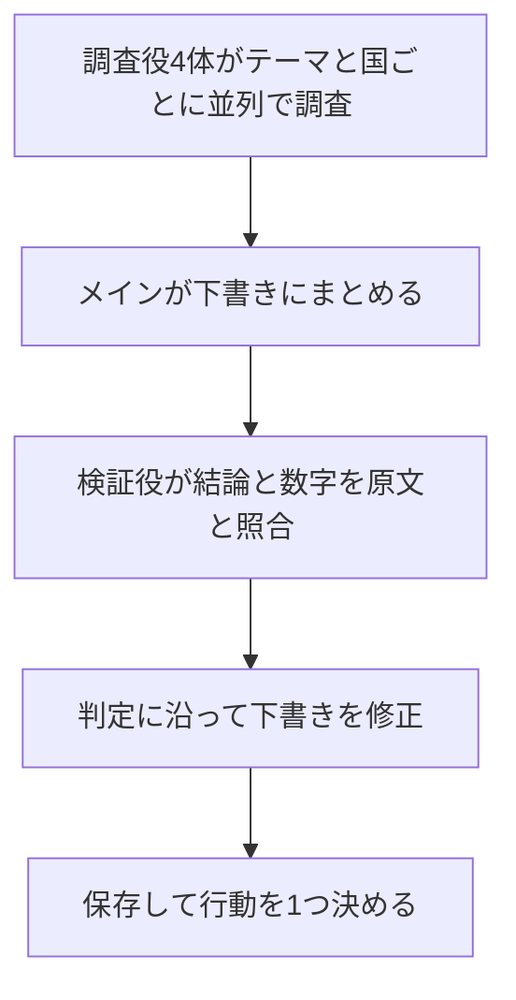

Claude Code のサブエージェントに調査を任せて、週1回のレポートを作っています。配布する前に出来を確かめようと、1本目のレポートを原文と照合しました。

**出典が付いていて、数字も合っていたのに、いちばん目立つ結論は出典で確かめられませんでした。**

調査やレポートをサブエージェントに任せていて、出てきた結論をどこまで信じていいか迷っている人に向けて、踏んだ落とし穴を書きます。

## TL;DR

- 照合できた出典11本で、金額と日付の誤りは0件でした。一方、いちばん目立つ結論は、海外の出典で確認できませんでした
- 「日本ではまだ」という判定の多くは「検索で見つからなかった」だけが根拠で、1か所は検索1回で崩れました
- まとめの後ろに検証役を置き、「未検出」と「不在」を書き分け、結論は期間内の記事だけで書くように直しました。修正後の手順はまだ回していません

## 背景

海外で先に盛り上がっていて、日本ではまだ薄い潮流。この「温度差」を週1回レポートにしたくて、Claude Code のスキルとして作りました。成功条件は、読んだあとに行動が1つ決まることです。

レポートには出典が35本付いていて、読んだ印象もそれらしいものでした。初回の合格条件は「すべての主張に出典がある」「10分で読める」など4つで、出典の中身が合っているかは条件に入れていませんでした。

## 構成

```text
~/.claude/
├── agents/researcher.md      # 調査役の定義。使えるツールとモデルを絞る
├── hooks/trend-reminder.sh   # 前回から7日空いたら提案するだけ（AIの使用量はゼロ）
└── skills/trend-scout/
    ├── SKILL.md              # 手順、調査役と検証役の指示、出力の型
    └── sources.md            # 国、ソース、主要企業、当たり外れの記録
```

調査役は、読み取りと検索だけができるサブエージェントです。

```yaml
---
name: researcher
description: 複数回のWeb検索やページの読み込みが必要な調べもので、メインの会話には結論と出典だけを持ち帰りたいときに使う
tools: WebSearch, WebFetch, Read, Grep, Glob  # 書き込みの権限は渡さない
model: sonnet
---
```

1回の流れは次のとおりです。C と D が、今回の監査を受けて足した部分です。



## 監査のやり方

1本目のレポートについて、3つを確かめました。

1. 主張が原文に書いてあるか。結論に使われた出典から順に開く
2. 「日本ではまだ」という判定を、別の検索で崩せるか
3. 出典の公開日が対象期間（14日、主力テーマは30日）に入っているか

照合できたのは35本のうち11本です。原文で8本、別の記事で3本を確かめました。残り24本は未照合なので、以下の数字はこの範囲の話です。

## 落とし穴1: 数字は合っているのに、結論がズレる

金額、日付、発言は、照合した範囲で誤りがありませんでした。

問題はその上に乗った結論でした。結論の1行目は、要約すると「AI同士が先に会話して引き合わせるマッチングで、海外が大きく先行している」です。原文を読むと、次のとおりでした。

| 根拠にしたサービス | 原文に書いてあったこと |
|---|---|
| 海外の資金調達企業 | AIが仲介する。AI同士の会話は明示なし |
| 海外の大手 | 利用者とAIの対話 |
| 日本の新興企業 | AI同士が先に対話すると明記 |

AI同士の対話を明記していたのは、照合した中では日本の1社だけでした。これでは「海外が先行」の根拠になりません。「対話型のAIを海外の大手が製品化している」までなら、出典と合います。

個別の事実は正しいのに、複数の事実を1つの潮流に束ねて名前を付けたところで、言葉が強くなったと見ています。調査役の出力を手元に残していないので、どの段階で起きたかは推測です。

対策として、検証役のサブエージェントを足しました。新しい情報は探さず、渡された主張が出典どおりかだけを確かめます。

```text
あなたは週報の検証役。新しい潮流は探さない。
渡された主張が出典どおりかだけを確かめて返す。
- 各主張の出典を WebFetch で開き、原文の該当箇所と突き合わせる
- 「未検出」とされた日本の熱量ごとに、日本語で反証検索を1回する

判定は次の4つのどれか
- 一致: 原文に同じ内容がある
- 強すぎる: 原文より断定が強い、範囲が広い、訳が強い
- 不一致: 原文に無い、または数字・日付が違う
- 照合不可: 原文も別の記事も確かめられない

あわせて、潮流名が根拠のサービス全部に当てはまるかも確かめる
```

「強すぎる」を判定に入れたのは、数字の照合だけでは今回のズレを拾えないからです。

## 落とし穴2: 「見つからなかった」が「日本にはない」に化ける

温度差の判定で、「見つからなかった」を根拠にした記述が7か所ありました。「無いことの証明ではない」と断り書きを入れた箇所もありますが、読み返すと「いない」と読めてしまいます。

実際に、1か所は検索1回で国内の参入企業が見つかりました。

そこで、調査役の返却形式を3択にしました。

```text
- 日本の熱量: 次の3つのどれかで書く
  - 確認済み: 社名・発表内容（出典）
  - 未検出（確認した社: A・B・C）
  - 未調査（理由）
- 温度差: 海外◎/○/△ 日本◎/○/△ ＋ 判定理由1行
  日本側が未検出だけなら末尾に「（暫定）」を付ける
```

あわせて、テーマごとの国内の主要企業をリストにして、社名で検索させています。社名を並べて1回で検索するより、1社ずつ検索したほうが各社の情報を拾いやすくなりました。

## 落とし穴3: 「今週の結論」が今週の情報ではなかった

| 指標 | 1本目のレポート |
|---|---|
| 出典の経過日数の中央値 | 70日 |
| 結論に使った出典7本の古さ | 50〜204日前 |
| 14日以内の出典 | 8本（うち5本は一覧・検索ページで、記事は3本） |

手元の環境の WebSearch には公開日で絞るパラメータがなく、検索に頼ると古い記事が混ざります。

直したのは2点です。

- 調査役に「期間内の根拠: あり／なし」を必ず返させ、「あり」の潮流だけを結論に使う。3行埋まらなければ行数を減らし、1行も書けなければ「今週は大きな動きなし」と書く
- 週次・月次のまとめやニュースルームなど、日付が付いた定点ページを最初に WebFetch で開く

旧手順のまま回した2本目では、期間内で本文まで確かめられた話題は1件だけでした。

## 落とし穴4: ルールを書いても初回で破られた

スキルには「本文未確認の記事は根拠に使わない」と書いてありました。それでも、本文を開けなかった記事が示唆の根拠に入っていました。

禁止事項をもう1行足しても、同じことが起きそうです。代わりに、検証役の返却項目に「本文未確認の出典を根拠にしている箇所」という欄を作りました。これで防げるかは、次に回してみないと分かりません。

## 落とし穴5: WebFetch がまとめて失敗する

照合の途中で、次のエラーが続きました。

```text
Unable to verify if domain www.example.com is safe to fetch.
```

| 同時に開いたページ数 | 結果 |
|---|---|
| 11 | 3件失敗 |
| 9 | 全滅 |
| 12 | 全滅（少しずつ開き直すと開けた） |

原因は特定できていません。回避策として、同時に開くのは4ページまで、失敗したら1回だけ開き直す、という指示を調査役と検証役の両方に入れました。

## まだ分かっていないこと

修正後の手順は、この記事の時点でまだ1本も回していません。ここまでに書いた対策の効果は未検証です。

照合できたのも35本のうち11本だけで、残り24本が合っているかは分かりません。検証役を足しても、検証役自身の読み違いは残ります。WebFetch がまとめて失敗する原因も、特定できていません。

次は新しい手順で週報を回して、検証役が実際に何を直すかを見ます。効くと確かめられたら、テーマ、国、主要企業を設定に切り出して、誰でも使える形にします。

## 参考リンク

- [Claude Code: Skills](https://code.claude.com/docs/en/skills)
- [Claude Code: Subagents](https://code.claude.com/docs/en/sub-agents)
